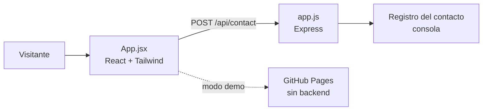

# Arquitectura

| Parte | Archivo | Qué hace |
|---|---|---|
| Página | `frontend/src/App.jsx` | Hero, beneficios, planes y formulario de email |
| Build | `frontend/vite.config.js` | React + Tailwind; proxy de `/api` a `:3001` en desarrollo; `base` configurable para Pages |
| API | `backend/src/app.js` | `GET /api/health` y `POST /api/contact` con validación del email |
| Arranque | `backend/src/index.js` | Levanta la API en `PORT` (3001 por defecto) |

## Variables de entorno

| Variable | Dónde | Uso |
|---|---|---|
| `VITE_API_URL` | frontend | URL del backend. Vacía en desarrollo (usa el proxy de Vite) |
| `VITE_DEMO` | frontend | `true` = sin backend, el formulario simula el envío (GitHub Pages) |
| `VITE_BASE` | build | Ruta base del sitio (`/mi-landing/` en Pages) |
| `PORT` | backend | Puerto de la API |

## Decisiones

- **`app.js` separado de `index.js`:** las pruebas levantan la app en un puerto libre sin arrancar el servidor real.
- **Modo demo en Pages:** GitHub Pages solo sirve archivos estáticos; para que el formulario funcione en línea hace falta desplegar el backend aparte (Render, Railway, Fly) y poner su URL en `VITE_API_URL`.

## CI/CD

- `ci.yml`: pruebas del backend (`node --test`), lint y build del frontend.
- `pages.yml`: build en modo demo y publicación en GitHub Pages en cada push.
